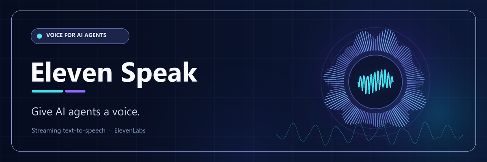

# 🔊 Eleven Speak



Give AI agents a voice with ElevenLabs: streaming text-to-speech, expressive audio tags, concurrent playback protection, and cached replay.

Use the Python CLI on its own, or pair it with an agent skill and instructions to add brief spoken notifications alongside written responses.

## 🤖 Set up an AI agent

Follow the steps for the agent you use, then configure Python and your
ElevenLabs API key. The agent skill guides when and how to speak; it does not
install dependencies, configure credentials, or automatically speak after
every response.

You need Python 3.10 or newer, an ElevenLabs account, an API key that permits
Text to Speech and voice-list requests, and an audio output device on the
machine running the agent. Audio played by a remote agent runs on the remote
machine, not automatically on your desktop.

#### Create an ElevenLabs account and API key

1. [Create an ElevenLabs account](https://elevenlabs.io/app/sign-up) and
   complete any email verification requested.
2. Open [API Keys](https://elevenlabs.io/app/settings/api-keys) in your
   account settings and create a key.
3. Give the key only the access this tool needs: Text to Speech generation
   (`POST /v1/text-to-speech/{voice_id}/stream`) and listing/searching voices
   (`GET /v2/voices`). The latter is needed to resolve voice names and for
   `--list-voices`; voice-ID selection still uses the voices endpoint in this
   CLI.
4. If the API key settings offer a credit quota, consider setting a limit for
   this key. Choose a voice, model, and output format available to your
   account; availability and pricing can vary by plan.
5. Store the key privately as `ELEVENLABS_API_KEY` in the environment used to
   start your agent, or in the skill's local `.env.local` as described below.
   Never paste the key into a prompt, commit it, or pass it as `--api-key`.

See ElevenLabs' official guides for [creating an
account](https://elevenlabs.io/docs/overview/administration/account),
[API key permissions and management](https://elevenlabs.io/docs/overview/administration/workspaces/api-keys),
[API authentication](https://elevenlabs.io/docs/api-reference/authentication),
[Text to Speech](https://elevenlabs.io/docs/api-reference/text-to-speech/stream),
and [listing voices](https://elevenlabs.io/docs/api-reference/voices/search).

### 📋 Prompt for your AI agent

Copy this prompt into Copilot or Claude Code to have it install and set up
Eleven Speak for the current project:

```text
Set up the Eleven Speak agent skill in this project, end to end.

1. Inspect the current project instructions and determine whether you are
   GitHub Copilot or Claude Code. Use only the installation path for this
   agent:
   - GitHub Copilot: preview and install
     neronotte/Elevenlabs.Skill / eleven-speak with GitHub CLI.
   - Claude Code: add neronotte/Elevenlabs.Skill as a plugin marketplace
     and install the eleven-speak plugin. If this checkout already contains
     the plugin, use it from this checkout instead.
2. Read the installed skill's SKILL.md and follow its setup guidance.
   Enable spoken notifications for completed tasks, blockers that need my
   input, and decisions by merging the instructions in the repository's
   .github/copilot-instructions.md into this project's existing
   .github/copilot-instructions.md (Copilot) or CLAUDE.md (Claude Code).
   Preserve existing instructions; do not replace or duplicate them.
3. Find the installed skill's scripts directory. Create a dedicated Python
   virtual environment there and install its requirements.txt. Do not install
   packages globally.
4. Check whether ELEVENLABS_API_KEY is configured without displaying,
   copying, logging, or sending its value anywhere. Never ask me to paste
   the key into chat or a command. If it is not configured, finish all other
   setup and tell me to configure it privately as described in SKILL.md.
5. Verify the installation without making an ElevenLabs API request or
   playing audio. Do not overwrite existing files, commit changes, or expose
   secrets. Report what you installed, what instructions you updated, and
   anything I still need to do.
```

or, if you want to install it in the plain old way, follow the instructions below...
### 🧠 GitHub Copilot

Install the skill from GitHub with GitHub CLI:

```shell
gh skill preview neronotte/Elevenlabs.Skill eleven-speak
gh skill install neronotte/Elevenlabs.Skill eleven-speak
```

Review the skill before installing it. By default, `gh skill install` installs
for the current project. If Copilot CLI was already open, run `/skills reload`.
Then ask Copilot to use the `eleven-speak` skill.

### 🐙 Claude Code

Add this GitHub repository as a Claude Code marketplace and install the
plugin:

```text
/plugin marketplace add neronotte/Elevenlabs.Skill
/plugin install eleven-speak@eleven-speak
```

Alternatively, from a local checkout, start Claude Code with:

```powershell
claude --plugin-dir .
```

If Claude Code is already running, follow its plugin reload/restart prompt if
shown. Ask Claude to use `eleven-speak`. To enable proactive notifications on
task completion, blockers, and decisions, add the same instructions shown
above to your project's `CLAUDE.md`. Installing the plugin alone does not add
these instructions or turn on automatic speech.

### 🗣️ Teach your agent to speak through the skill

To have Copilot use the skill proactively, add the following instructions to
your own `.github/copilot-instructions.md` or `CLAUDE.md`:

```markdown
## Spoken notifications

Alongside the written response, provide a brief spoken notification when:

- you complete a requested task;
- you encounter a blocker that requires the user's input;
- you need to ask the user to make a decision.

For these notifications, load and run the `eleven-speak` skill. Do not merely
announce that audio will play.

Do not speak for intermediate updates or individual tool calls. If the user
asks for silence, do not play audio. If speech playback fails, report that in
writing and continue without repeated attempts.
```

The skill installation does not add these instructions to your project
automatically. If you only want occasional speech, skip this step and ask
Copilot to use the skill when needed.


### ⚙️ Configure Python and the API key

The skill includes the CLI and its dependency list. Find the installed
`eleven-speak` skill directory (for Claude Code, the loaded skill's directory
is shown in its skill details), then run these commands from its `scripts`
subdirectory to create a dedicated environment and install dependencies.

Windows / PowerShell:

```powershell
Set-Location "<skill-directory>\scripts"
python -m venv .venv
& ".\.venv\Scripts\python.exe" -m pip install -r ".\requirements.txt"
```

macOS / Linux:

```bash
cd "<skill-directory>/scripts"
python3 -m venv .venv
.venv/bin/python -m pip install -r requirements.txt
```

Configure `ELEVENLABS_API_KEY` in the environment used to launch your agent,
or create `.env.local` next to `eleven_say.py` in the installed skill's
`scripts` directory. Do not put the key in prompts, source files, command
history, or a committed file. The project `.gitignore` protects local
`.env.local` files in this repository; if the skill was installed elsewhere,
ensure its `.env.local` is kept private too.

Once set up, ask the agent to use the skill for a short spoken message. New
speech is sent to ElevenLabs and may consume credits; replaying the last
cached note is local. For privacy and behavior details, see the skill and
the sections below.

## ✨ Features

- **Streaming playback:** plays audio as it arrives, without waiting for a complete MP3 file.
- **Voice selection:** accepts a ElevenLabs voice ID or a voice name.
- **Expressive speech:** defaults to `eleven_v4`, with audio tags embedded in the input text.
- **Local replay:** keeps the latest successfully cached message for each voice.
- **Concurrent playback protection:** a shared interprocess lock prevents cooperating invocations from speaking over one another.
- **Bounded waiting:** configurable lock, operation, and HTTP timeouts.
- **No helper processes:** a watchdog thread runs inside the CLI process.
- **Agent guidance:** a skill documents when to speak, how to use audio tags, and privacy precautions.

## 📋 Requirements

- Python 3.10 or newer.
- An ElevenLabs account and API key with access to Text to Speech and voice listing/search; see [Create an ElevenLabs account and API key](#create-an-elevenlabs-account-and-api-key).
- A voice, model, and output format available to your account.
- A working local audio output device.
- Packages from `requirements.txt`: `elevenlabs`, `sounddevice`, and `portalocker`.

Playback uses 24 kHz, 16-bit mono PCM through `sounddevice` and PortAudio. No FFmpeg, MPV, or external MP3 player is required.

Windows and macOS installations normally obtain PortAudio through the `sounddevice` package. Linux may require a system PortAudio package and a configured audio backend. Platform-specific audio availability must be checked on the target machine.

> Audio plays on the machine running Python. Running the CLI on a remote host does not automatically play sound on your desktop.

## 💻 Manual CLI installation

Use these instructions only if you want to run the Python script yourself in a
terminal, independently of Copilot or Claude Code. The commands assume
`eleven_say.py` and `requirements.txt` are in the current directory; in this
repository, they are in `.github/skills/eleven-speak/scripts`.

### 🪟 Windows / PowerShell

```powershell
python -m venv .venv
& ".\.venv\Scripts\python.exe" -m pip install -r requirements.txt
```

### 🐧 macOS / Linux

```bash
python3 -m venv .venv
.venv/bin/python -m pip install -r requirements.txt
```

Examples below use `python`. Substitute the virtual environment's interpreter if you have not activated it.

## 🔑 API key configuration

Create `.env.local` next to `eleven_say.py`:

```dotenv
ELEVENLABS_API_KEY=your_api_key_here
```

The file must contain `NAME=value`, not just the key. Save it as UTF-8 without a BOM. The loader supports simple assignments and optional surrounding quotes; it is not a full dotenv parser.

Alternatively, set the environment variable:

```powershell
$env:ELEVENLABS_API_KEY = "your_api_key_here"
```

```bash
export ELEVENLABS_API_KEY="your_api_key_here"
```

The script checks these sources in order:

1. Existing process environment variables.
2. `.env.local` in the current working directory.
3. `.env` in the current working directory.
4. `.env.local` next to the script.
5. `.env` next to the script.

The first assignment wins. An existing empty environment variable also prevents the file loader from replacing it. Run from a trusted working directory to avoid loading unexpected configuration.

The CLI also accepts `--api-key`, which takes precedence, but environment variables or a local configuration file are preferable because command-line arguments can expose secrets.

**Never commit API keys.** Add entries such as these to your repository's `.gitignore`:

```gitignore
.env
.env.local
.off
.venv/
__pycache__/
```

## 🔇 Disable the CLI

Create an empty file named `.off` in the same directory as `eleven_say.py`
to disable all invocations:

```powershell
New-Item -ItemType File -Force -Path ".off"
```

```bash
touch .off
```

The script exits with code `0` and a message on standard error, without
calling ElevenLabs, playing cached audio, or cleaning the cache. Remove the
file to re-enable it. The location is based on the script directory, not the
current working directory.

Invocations waiting for the playback lock check again after obtaining it.
Creating `.off` does not stop audio or an API request already in progress;
there is still a small race between the final check and starting an operation.
The marker is local to that copy of the script, not a global switch.

## 🚀 Quick start

Speak a message with the default model:

```powershell
python eleven_say.py "The task is complete." --voice "21m00Tcm4TlvDq8ikWAM"
```

Use a voice name:

```powershell
python eleven_say.py "Hello!" --voice "Rachel"
```

Voice names are resolved through the API and cached locally. Name matching can select a prefix match, so **voice IDs are recommended** for predictable agent behavior.

List up to 100 available voices:

```powershell
python eleven_say.py --list-voices
```

Read text from standard input:

```powershell
"Your build has finished." | python eleven_say.py --voice "21m00Tcm4TlvDq8ikWAM"
```

Repeat the latest cached message for that voice:

```powershell
python eleven_say.py --replay --voice "21m00Tcm4TlvDq8ikWAM"
```

Replay does not call ElevenLabs and does not require an API key. Prefer the same voice ID used for generation; replay by name depends on the local name-to-ID index still being available.

## 🎭 Audio tags

Audio tags are instructions embedded in `text`, not a separate API argument:

```powershell
python eleven_say.py "[excited] It works! [laughs] That was worth the effort." --model eleven_v4 --voice "21m00Tcm4TlvDq8ikWAM"
```

Use English tags even when the spoken text is in another language:

```powershell
python eleven_say.py "[curious] Preferisci mantenere questa voce?" --model eleven_v4 --voice "21m00Tcm4TlvDq8ikWAM"
```

| Tag | Intended effect | Suggested use |
| --- | --- | --- |
| No tag | Natural delivery | Routine notifications and technical updates |
| `[curious]` | Curious delivery | A genuine question or choice |
| `[excited]` | Enthusiasm | A meaningful positive result |
| `[whispers]` / `[whispering]` | Whispering | An explicitly requested delivery style |
| `[laughs]` / `[laughing]` | Laughter | Shared humor, not errors or user difficulties |
| `[sighs]` / `[exhales]` | A sigh or exhalation | Requested expressive narration |
| `[sarcastic]` | Sarcasm | Only when explicitly wanted |

Start with one or two tags per short message. They are generative guidance, not deterministic controls: interpretation depends on the voice, wording, and generation. There is no exhaustive list of guaranteed tags.

`eleven_v4` and `eleven_v3` support audio-tag prompting; the earlier `eleven_flash_v2_5` default does not provide this feature. Model availability and API compatibility depend on the service and your account.

Do not use closing tags such as `[/excited]`. For v4, use punctuation or ellipses for pacing rather than SSML `<break>` tags; exact pause durations are not guaranteed.

Changing tags or models requires a new generation. `--replay` plays the previously cached audio unchanged.

See the [ElevenLabs prompting guide](https://elevenlabs.io/docs/overview/capabilities/text-to-speech/best-practices#audio-tags) and the skill for additional examples and usage guidance.

## 🛠️ Command-line options

| Option | Default | Purpose |
| --- | --- | --- |
| `text` | Read from stdin | Text to synthesize |
| `-v`, `--voice` | `21m00Tcm4TlvDq8ikWAM` | Voice ID or name |
| `-m`, `--model` | `eleven_v4` | ElevenLabs model ID |
| `-r`, `--replay` | Off | Play the latest cached message for the voice |
| `--ttl` | `30` | Cache cleanup age in minutes |
| `--no-cache` | Off | Do not save newly generated audio |
| `--list-voices` | Off | List up to 100 available voices |
| `--lock-timeout` | `120` | Maximum lock acquisition wait, in seconds |
| `--operation-timeout` | `180` | Maximum operation time after acquiring the lock, in seconds |
| `--http-timeout` | `30` | SDK HTTP timeout, in seconds |
| `--api-key` | Environment / env file | Explicit API key; avoid exposing secrets in arguments |

The three timeout options must be positive, finite numbers. Increase `--operation-timeout` for long readings:

```powershell
python eleven_say.py "A longer narration..." --operation-timeout 600 --lock-timeout 300
```

Environment defaults are also available:

| Variable | Purpose |
| --- | --- |
| `ELEVENLABS_API_KEY` | API authentication |
| `ELEVENLABS_VOICE` | Default voice |
| `ELEVENLABS_MODEL` | Default model |
| `ELEVEN_SAY_TTL_MIN` | Default cache cleanup age |
| `ELEVEN_SAY_CACHE` | Custom cache directory |

**Implementation note:** only the API key is read after the env files are loaded. Set voice, model, TTL, and cache variables in the process environment before launching, or use the corresponding CLI options where available. Putting these defaults in `.env.local` does not currently configure them.

CLI help and some error messages are currently in Italian.

## 🔒 Concurrency and timeouts

All cooperating invocations for the same user share an OS-backed lock, independent of voice and cache directory:

```text
Wait for lock
  -> start watchdog
  -> clean cache
  -> generate and play, replay, or list voices
  -> publish cache updates
  -> stop watchdog
  -> release lock
```

This prevents overlapping playback and concurrent cache writes. **Strict FIFO ordering is not guaranteed.** It does not prevent unrelated applications from playing audio.

The lock is stored at:

- Windows: `%LOCALAPPDATA%\eleven_say\playback.lock`
- Other systems, when `LOCALAPPDATA` is unset: `~/eleven_say/playback.lock`

The lock file may remain on disk after execution. Its existence does not mean it is locked. **Do not delete or recreate it to force an unlock.**

The lock acquisition timeout bounds a waiting invocation; it does not terminate the current owner. Once acquired, the operation watchdog bounds cleanup, API calls, playback, and cache updates. Argument parsing, configuration loading, and reading stdin happen before that watchdog starts.

HTTP timeouts are separate from the overall operation limit. Automatic SDK retries are disabled for the API calls used by this script.

If the operation deadline expires, the watchdog thread reports an error and forcibly exits its own process with code `124`. This can cut off audio and skips Python cleanup handlers; the OS closes handles and releases the lock.

> This is a practical safeguard, not a hard real-time guarantee. A native call that holds Python's GIL indefinitely can prevent the watchdog thread from running.

## 💾 Cache behavior

Default cache locations:

- Windows: `%LOCALAPPDATA%\eleven_say\cache`
- Other systems, when `LOCALAPPDATA` is unset: `~/eleven_say/cache`

Set `ELEVEN_SAY_CACHE` in the process environment to use a different directory. Use a dedicated directory: cleanup removes `.tmp` files inside it.

- Audio is cached as WAV, not MP3.
- Each voice retains only its latest successfully cached message.
- Audio and the voice-name index are published through atomic file replacement.
- Interrupted temporary writes are cleaned up during the next locked operation.
- Expired WAV files and the voice index are removed when the script next runs.
- `--ttl` applies to cleanup during that invocation; it is not a per-file expiration setting.
- Replay does not refresh a note's expiration time.
- `--no-cache` skips saving the new note; it does not erase previously cached notes.

**There is no background cleanup or total disk-size limit.** Files can remain after their TTL if the script is not run again. Cached audio is uncompressed, and generation currently retains the audio in memory when caching is enabled, so short agent notifications are the intended workload.

## 🔐 Privacy and cost

- New synthesis requests send text to ElevenLabs and may consume account credits.
- Local replay makes no synthesis request.
- Spoken output can be heard by people nearby.
- Cached recordings remain on disk until overwritten or cleaned up.
- Do not send API keys, confidential source code, personal data, or sensitive business content to the speech service.
- `--no-cache` prevents saving new audio locally; it does not prevent transmission to ElevenLabs.

For agent notifications, prefer a generic message such as "The task is complete; details are in the written response" over reading sensitive details aloud.

## 🩺 Troubleshooting

| Problem | What to check |
| --- | --- |
| API key not found | Use `ELEVENLABS_API_KEY=value`; check file location, encoding, and existing environment variables |
| Audio tags have no effect | Confirm the selected model supports tags; try simple tags and a suitable voice |
| No audio output | Check the playback machine, default output device, PortAudio, and system audio configuration |
| Replay is unavailable | Use the same voice ID; the note may have expired, never been cached, or been generated with `--no-cache` |
| Lock wait expires | Another invocation may still be running; increase the wait budget if appropriate |
| Operation is interrupted | Increase the operation budget for long speech; investigate slow network or blocked audio |
| Voice selection is unexpected | Use an explicit voice ID instead of a name |

## 🚦 Exit codes

| Code | Meaning |
| --- | --- |
| `0` | Command completed |
| `1` | Missing replay audio, or an unhandled runtime error |
| `2` | Invalid CLI arguments or missing required input/configuration |
| `75` | Lock acquisition failed or timed out |
| `124` | Operation watchdog forced termination |
| `130` | Interrupted with Ctrl+C |

A successful exit does not prove that the user heard the audio or that every tag was rendered as intended.

## 🧪 Tests

Run the local test suite from the repository root:

```powershell
python -m unittest discover -s test -p "test_*.py" -q
```

The tests exercise interprocess exclusion, lock waiting, watchdog cancellation and termination, atomic cache updates, temporary-file cleanup, and timeout validation. They use local test subprocesses, not ElevenLabs synthesis requests; production invocations do not spawn helper processes.
